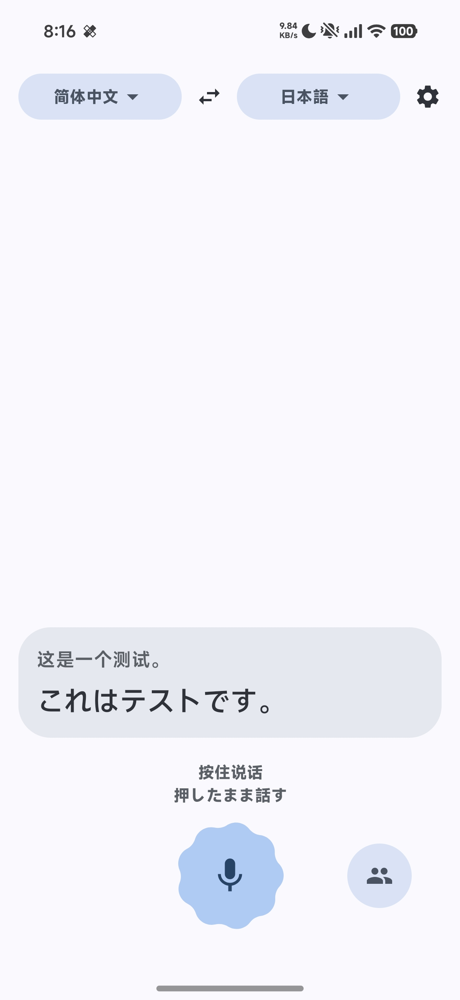
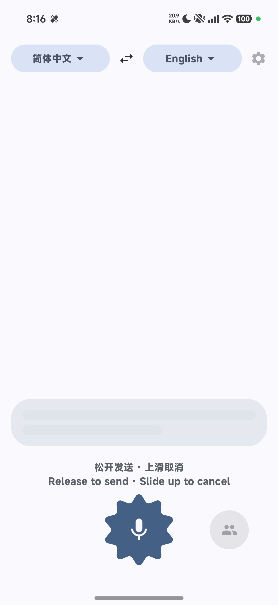
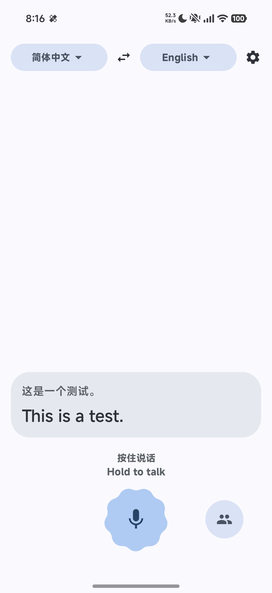
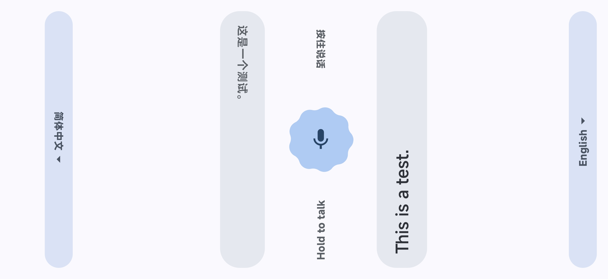

<div align="center">

# 🗣️ Parley

Eine quelloffene Android-App für Übersetzungen im direkten Gespräch.

[](https://github.com/EvATive7/Parley/releases/latest)


[English](README.md) | [简体中文](README.zh-CN.md) | [繁體中文](README.zh-TW.md) | [日本語](README.ja.md) | [한국어](README.ko.md) | [Français](README.fr.md) | **Deutsch** | [Español](README.es.md)

[**APK herunterladen**](https://github.com/EvATive7/Parley/releases/latest)

</div>

---

Halte die Taste gedrückt, sprich und lass sie zum Übersetzen los. Die andere Person macht dasselbe, und beide sehen jeweils die Übersetzung. Parley eignet sich für Situationen, in denen eine sofortige Verständigung nötig ist, etwa bei der Wegsuche im Ausland oder in mehrsprachigen Besprechungen.

<div align="center">
<table>
<tr>
<td></td>
<td></td>
<td></td>
</tr>
<tr>
<td align="center">Übersetzungsergebnis</td>
<td align="center">Zum Aufnehmen gedrückt halten</td>
<td align="center">Zweisprachige Hinweise</td>
</tr>
</table>



*Gegenüber-Modus: Der Bildschirm wird geteilt, sodass jede Hälfte einer Person zugewandt ist.*

</div>

## ✨ Funktionen

- **Automatische Übersetzungsrichtung**: Wähle zwei Sprachen aus. Gesprochenes wird ohne manuelles Umschalten automatisch in die jeweils andere Sprache übersetzt.
- **Streaming-Ausgabe**: Die Übersetzung erscheint fortlaufend, ohne dass du auf den vollständigen Satz warten musst.
- **Gegenüber-Modus**: Lege das Smartphone flach auf einen Tisch. Der Bildschirm wird geteilt, jede Hälfte zeigt zu einer Person und stellt nur die Sprache des Gegenübers dar.
- **Zum Sprechen gedrückt halten**: Halte zum Aufnehmen gedrückt, lass zum Senden los oder wische zum Abbrechen nach oben.
- **Zweisprachige Hinweise**: Die Bedienhinweise werden in beiden Sprachen angezeigt, damit beide Personen sie verstehen.
- **Kartenaktionen**: Tippe auf eine Karte, um den vollständigen Text anzuzeigen, zu kopieren oder zu löschen. Fehlgeschlagene Übersetzungen lassen sich wiederholen.
- **Direkte Ende-zu-Ende-Verbindung**: Es gibt keinen Zwischenserver. Audio und Text werden direkt an die von dir konfigurierten Anbieter gesendet; API Keys werden mit Android Keystore verschlüsselt gespeichert.

## 📦 Erste Schritte

1. Lade die APK unter [Releases](https://github.com/EvATive7/Parley/releases/latest) herunter und installiere sie (Android 8.0 oder neuer ist erforderlich).
2. Öffne über das Zahnrad oben rechts die Einstellungen und konfiguriere einen Spracherkennungsdienst sowie einen OpenAI-kompatiblen Übersetzungsdienst.
3. Wähle die beiden Sprachen aus, halte die Taste gedrückt und sprich.

> Parley selbst ist kostenlos, stellt aber keine Konten oder Nutzungsguthaben bereit. Die Kosten für Spracherkennung und Übersetzung werden von den ausgewählten Anbietern berechnet.

## 🎙️ Spracherkennungsdienste

| Anbieter | Dienst | Erforderliche Konfiguration |
| --- | --- | --- |
| Alibaba Cloud DashScope | Fun-ASR-RealTime (Streaming / Nicht-Streaming) | API Key und Region (Peking oder Singapur) |
| OpenAI | GPT Realtime Whisper, GPT-4o Transcribe, GPT-4o Mini Transcribe | API Key |
| Volcengine | Doubao Seed ASR 2.0 (Streaming / Nicht-Streaming / Nicht-Streaming Turbo) | AppID und Access Token; die entsprechende Ressource muss in der Konsole aktiviert sein |

Streaming-Dienste liefern Ergebnisse bereits während des Sprechens. Nicht-Streaming-Dienste geben das Ergebnis nach dem Sprechen auf einmal zurück und sind in der Regel genauer. Verschiedene Dienste desselben Anbieters verwenden einen gemeinsamen Satz Anmeldedaten.

## 🌏 Unterstützte Sprachen

**Übersetzung und Benutzeroberfläche**: Englisch, vereinfachtes Chinesisch, traditionelles Chinesisch, Japanisch, Koreanisch, Französisch, Deutsch, Spanisch, Italienisch, Portugiesisch, Russisch, Arabisch, Thailändisch, Vietnamesisch und Indonesisch.

Welche Sprachen tatsächlich erkannt werden, hängt vom gewählten Spracherkennungsdienst ab. Der Streaming-Dienst von Volcengine unterstützt beispielsweise nur Chinesisch und Englisch.

## 🔒 Datenschutz

- Audio und Text werden nur an die von dir konfigurierten Anbieter gesendet und durchlaufen keinen Zwischenserver.
- Aufnahmen werden ausschließlich im Arbeitsspeicher verarbeitet. Unterhaltungen werden nicht dauerhaft gespeichert und gehen beim Schließen der App verloren.
- API Keys werden mit Android Keystore verschlüsselt, nicht in Protokolle geschrieben und nicht in Sicherungen aufgenommen.

## ❓ Häufig gestellte Fragen

<details>
<summary><b>Warum ist die Übersetzungsrichtung manchmal falsch?</b></summary>

Wenn der Spracherkennungsdienst keine Sprachinformation zurückgibt, bestimmt Parley die Sprache lokal. Sehr kurze Sätze oder gemischte chinesische und englische Inhalte können falsch erkannt werden. Wenn keine Sprache bestimmt werden kann, übersetzt Parley in die zweite ausgewählte Sprache.

</details>

<details>
<summary><b>Was geschieht mit bereits gesendetem Audio, wenn ich zum Abbrechen nach oben wische?</b></summary>

Bei einem Streaming-Dienst wird das Audio in Echtzeit gesendet, solange du die Taste gedrückt hältst. Beim Abbrechen wird die weitere Übertragung sofort beendet und das Ergebnis verworfen. Bereits gesendetes Audio kann jedoch nicht zurückgerufen werden.

</details>

<details>
<summary><b>Warum muss ich meine Schlüssel nach einer Neuinstallation erneut eingeben?</b></summary>

Die Schlüssel sind an den verschlüsselten Gerätespeicher gebunden und werden nicht gesichert. Nach einer Neuinstallation der App oder wenn das System seine Verschlüsselungsschlüssel zurücksetzt, musst du sie erneut konfigurieren.

</details>

<details>
<summary><b>Wie kann ich ein Problem untersuchen?</b></summary>

Aktiviere in den Einstellungen den **Debug-Modus**, um ein schwebendes Protokollfenster in der App anzuzeigen. Kopiere das Protokoll und melde das Problem unter [Issues](https://github.com/EvATive7/Parley/issues).

</details>

## 🛠️ Entwicklung

<details>
<summary>Build, Veröffentlichung und Projektstruktur</summary>

### Build

JDK 17+ und Android SDK Platform 37 sind erforderlich.

```sh
./gradlew testDebugUnitTest
./gradlew lintDebug
./gradlew assembleDebug
./gradlew assembleRelease
```

Die Ausgaben befinden sich unter `app/build/outputs/apk/{debug,release}/`. Das Debug-Paket heißt `io.github.evative7.parley.debug`, verwendet den App-Namen „Parley Debug“ und ein bernsteinfarbenes Symbol und kann parallel zur Release-Version installiert werden. Lokale Builds verwenden die feste Version `0.1.0`. Wenn `app/release.jks` fehlt, wird die release APK mit dem debug Schlüssel signiert.

### Veröffentlichung

Das Git-Tag ist die einzige Quelle der Versionsnummer. Das Pushen eines annotierten Tags startet `.github/workflows/release.yml`:

```sh
git tag -a v0.5.0 -m "Release v0.5.0"
git push origin v0.5.0
```

Die CI liest `versionName` aus dem Tag, berechnet `versionCode` mit `major*10000 + minor*100 + patch`, führt die Unit-Tests aus, signiert die APK und lädt sie in ein GitHub Release hoch. Im Repository müssen die Secrets `KEYSTORE_BASE64` (base64 von `release.jks`), `KEYSTORE_PASSWORD`, `KEY_ALIAS` und `KEY_PASSWORD` hinterlegt sein.

Volcengine-Ressourcen-IDs: `volc.seedasr.sauc.duration`, `volc.seedasr.auc` und `volc.bigasr.auc_turbo`.

### Projektstruktur

```
app/src/main/java/io/github/evative7/parley/
├─ ui/        UI, Sprechtaste, Karten, Gegenüber-Layout, Diensteinstellungen
├─ state/     TranslateViewModel, SettingsViewModel, Zustandsautomat der Sprechtaste
├─ audio/     Aufnahme, Lautstärke, WAV und Resampling
├─ asr/       Sprachdienst-Voreinstellungen und Routing; DashScope-, OpenAI- und Volcengine-Erkennung
├─ translate/ OpenAI-kompatible Streaming-Übersetzung
├─ network/   SSE-Parsing, Verbindungsaufbau, bereinigte Dienstfehler
├─ model/     Sprachen und lokale Spracherkennung
├─ data/      Einstellungen, Übersetzungsdienste, Schlüsselablage mit Keystore
├─ debug/     App-internes Debug-Protokoll
├─ tts/       Nur die Text-to-Speech-Schnittstelle
└─ di/        Hilt-Bindings und Netzwerkkonfiguration
```

### Dokumentation

- [API-Referenz der Sprachdienste](docs/APIs/transcriber/README.md)

</details>
